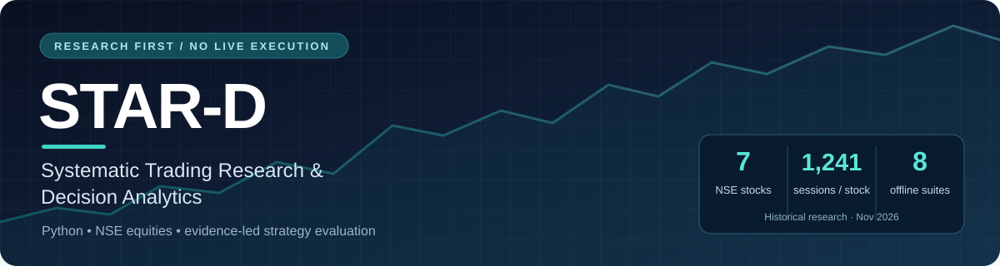

<p align="center">
  
</p>

<h1 align="center">STAR-D</h1>
<p align="center"><strong>Systematic Trading Research & Decision Analytics</strong><br/>
A Python-based research platform for testing rule-driven strategies on Indian equities.</p>

<p align="center">
  
  
  
  
  
</p>

> **Research, not an investment product.** Results below are historical simulations, **not live returns** or evidence of a reliable future trading edge. Broker-linked paper trading and external DC refresh are disabled. Raw Kite market data, credentials and private journals are not included.

## At a glance

| Research coverage | Historical DC 5% holdout | Validation status |
|:---:|:---:|:---:|
| **7 NSE equities** | **+3.28%** mean net return | **Forward edge not established** |
| **1,241 daily sessions / stock** | **15.03%** mean max drawdown | **No live order execution** |
| **~5 years of market history** | **33** closed trades · **33.33%** win rate | **Synthetic offline checks available** |

**Universe:** INFY · TCS · WIPRO · HDFCBANK · ICICIBANK · SBIN · ITC  
**Evaluation:** development window (994 sessions) and chronological holdout (247 sessions). The final dates had been inspected in earlier work, so **the holdout was not fully untouched**.

## Historical strategy comparison

*Chronological holdout: 24 Nov 2025–20 Nov 2026 · Mean returns across seven separate stock simulations · Estimated fees and 0.05% slippage per fill for trading strategies.*

| Approach | Mean net return | Mean max drawdown | Closed trades |
|---|---:|---:|---:|
| **Directional Change — 5%** | **+3.28%** | **15.03%** | 33 |
| SMA 6/30 | −10.15% | 21.60% | 32 |
| Buy and hold | −9.87% | 31.02% | — |

**Reality check:** DC 5% returned **+1.07%** under higher assumed costs and **−2.17%** under severe costs. Only **3 of 7 stocks** had a positive DC holdout return. These are averages of simulated results—not portfolio returns, forward profits or recommendations.

[Methods, full development comparison and limitations](docs/research/research-log.md)

## How the system fits together

```text
NSE equity research → SMA / DC signal rules → historical backtests
                                                ↓
                             costs, slippage & robustness checks
                                                ↓
                          offline validation + research reporting
                                                ↓
                      forward validation (pending sufficient evidence)
```

| Component | What it does |
|---|---|
| **Scanner & dashboard** | Streamlit interface, moving-average signals, derived exports and reporting views |
| **SMA 6/30 research** | Crossovers, next-session-open simulated fills and buy-and-hold comparison |
| **DC 5% research** | Fixed reversal threshold, trade simulation and cost/market stress tests |
| **TradingView** | Pine v6 visual signals and an offline cross-check against Python logic |
| **Offline safeguards** | Synthetic-data testing, data-retention protections and broker-action restrictions |

**Stack:** Python · pandas · NumPy · Streamlit · Zerodha Kite Connect (authorized research access) · TradingView Pine Script · SQLite (local-only journals).

## Build journal — dated achievements

| Date (IST) | Shipped / achieved | Challenge or lesson |
|---|---|---|
| **22 Nov 2026** | Set up Python research, read-only broker access, INFY charting, initial SMA experiments and multi-stock scanning | Data capture and basic signal validation |
| **23 Nov 2026** | Extended SMA 6/30 and DC 5% studies to seven stocks; added cost stress tests, TradingView strategy, reporting, paper-trading research modules and repository history | A historical improvement is **not** proof of live profitability; chart-feed parity needs more checking |
| **26 Nov 2026** | Updated source and documentation for a compliance-safe public release; added synthetic shadow execution and data-retention checks | Paused broker-linked simulations and removed raw-market-data persistence paths |
| **27 Nov 2026** | Refreshed the project showcase with dated milestones and research metrics | Keep results clearly distinguished from deployable trading performance |

[Detailed project history](docs/project-history.md) · [Changes](CHANGELOG.md) · [Security & data-retention audit](docs/security/repository-audit.md)

## Milestone tracker

- [x] **Foundation:** Python, broker research access, scanner and Streamlit interface
- [x] **Historical research:** SMA 6/30 vs DC 5% vs buy-and-hold; transaction-cost sensitivity
- [x] **Documentation:** experiment log, daily history, repository security and public-safe sources
- [x] **Safeguards:** broker-linked paper execution disabled; synthetic offline test fixtures
- [ ] **Reproducibility:** pin and validate dependencies; introduce an automated offline test workflow
- [ ] **Cross-platform verification:** check TradingView/Python signals on matching seven-stock candles and test alert behavior
- [ ] **Forward validation:** collect enough compliant out-of-sample observations, audit costs and missed fills
- [ ] **Research extension:** separately evaluate event-driven signals and compounding without changing the DC 5% baseline

**Forward readiness criteria (not yet met):** ≥60 complete sessions · ≥30 closed round trips · positive net expectancy · ≤20% observed drawdown · data-freshness and missed-fill checks. See [forward-test criteria](docs/research/research-log.md#forward-test-criteria).

## Explore the repository

| Start here | Contents |
|---|---|
| [Local setup & offline checks](docs/setup/local-workflows.md) | Environment, Streamlit dashboard and synthetic offline test commands |
| [Research log](docs/research/research-log.md) | Full performance tables, assumptions and cost sensitivity |
| [Project history](docs/project-history.md) | Chronology of the initial build |
| [Roadmap](ROADMAP.md) | Next engineering and validation priorities |
| [Data-retention audit](docs/security/repository-audit.md) | Included/excluded files and licensing limitations |
| [Pine strategy](dc_5_percent_strategy.pine) | TradingView implementation |

---

<p align="center"><sub>Built with an engineering-first approach: document assumptions · test with evidence · preserve failure cases · never confuse a backtest with a live edge.</sub></p>
